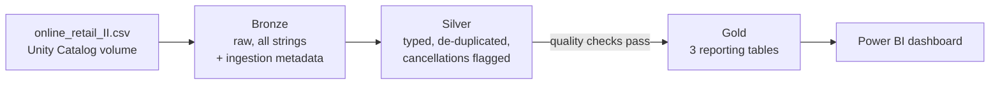

# Retail Sales Lakehouse (Databricks · PySpark · Delta Lake)

A Medallion-architecture pipeline that turns the raw **UCI Online Retail II** dataset
(about 1 million transaction lines from a UK online retailer, 2009–2011) into clean,
business-ready Delta tables for a Power BI sales dashboard.

**Tools:** Databricks (Free Edition) · PySpark · Delta Lake · Unity Catalog volumes · Power BI · pytest · GitHub Actions

## Why I built it

Lakehouse platforms like Databricks and the Bronze / Silver / Gold pattern are now standard
in data engineering. My background is in validating data pipelines, so I wanted to build a
full pipeline myself, from messy raw files to reporting tables, with data quality checks
gating every step.

## Architecture



| Layer | Table | What happens |
|---|---|---|
| Bronze | `bronze_transactions` | CSV loaded as-is, plus `_ingested_at` and `_source_file` for traceability |
| Silver | `silver_transactions` | Snake_case columns and proper types; two date formats parsed; exact duplicates removed; postage, fees and adjustments removed; zero prices removed; cancellations flagged (`C` invoices); `line_revenue` calculated; partitioned by month |
| Gold | `gold_revenue_by_month_country` | Gross and net revenue (after returns), orders and customers per month and country |
| Gold | `gold_product_performance` | Units sold, units returned, return rate and revenue rank per product |
| Gold | `gold_customer_summary` | Recency, frequency and monetary value (RFM) per known customer |

## Data quality checks (Silver)

The Silver write only happens if every check passes; otherwise the notebook stops with a report:

- minimum row count
- no nulls in key columns (invoice, stock code, quantity, price, timestamp, country)
- no duplicate transaction lines
- all prices positive
- quantity sign matches the cancellation flag (returns negative, sales positive)

## Run it on Databricks Free Edition

1. Sign up at [Databricks Free Edition](https://www.databricks.com/learn/free-edition).
2. **Workspace → Create → Git folder**, and paste this repository's URL.
3. Run `notebooks/00_setup.py` to create the `workspace.retail` schema and `raw` volume.
4. Download the dataset as CSV (for example the Kaggle "Online Retail II UCI" CSV, or export
   both sheets of the [UCI Excel file](https://archive.ics.uci.edu/dataset/502/online+retail+ii) to CSV)
   and upload it to **Catalog → workspace → retail → raw**.
5. Run `01_bronze`, `02_silver` and `03_gold` in order (or chain them as a Databricks Job).

## Power BI dashboard

Connect Power BI Desktop to the workspace (**Get Data → Azure Databricks**, using the SQL
warehouse's server hostname and HTTP path) and load the three Gold tables. Suggested visuals:
monthly net revenue line, revenue by country map, top 10 products, return rate by product.

## Results

_Fill in after running:_ Bronze rows · Silver rows · rows removed by cleaning · checks passed ·
top country by revenue · dashboard screenshot (`docs/dashboard.png`).

## Tests

The transformation logic lives in `src/retail_lakehouse/` and is tested locally with Spark on a
small hand-built dataset (duplicates, fees, zero prices, returns, two date formats, missing
customer IDs). Requires Java 17+.

```bash
pip install -r requirements-dev.txt
pytest
ruff check .
```

## Project structure

```
notebooks/00_setup.py ... 03_gold.py   Databricks notebooks, one per layer
src/retail_lakehouse/transforms.py     Bronze / Silver / Gold transformations
src/retail_lakehouse/quality.py        Silver data quality checks
tests/                                 Unit tests on local Spark
```

## Next steps

- Incremental loads with Auto Loader and `MERGE` instead of full overwrites
- Schedule the notebooks as a Databricks Job
- Slowly changing customer dimension (SCD Type 2)
